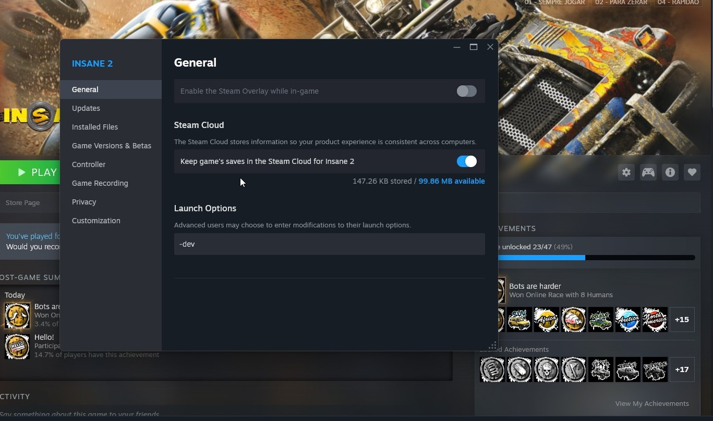
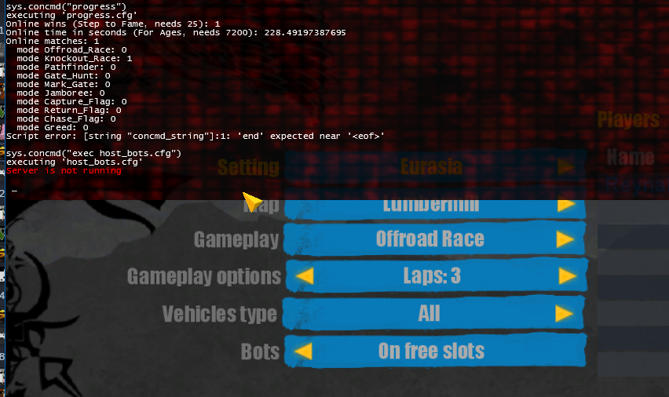
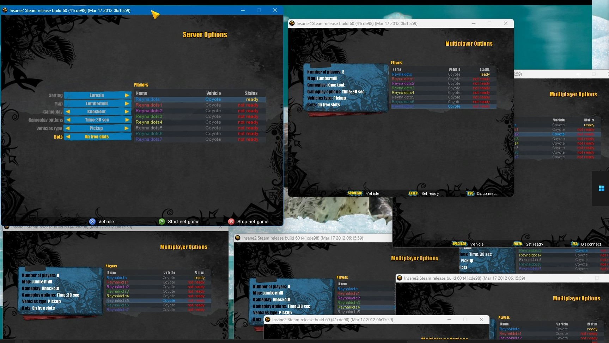
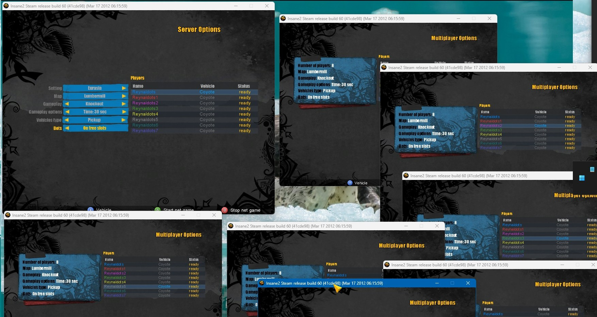
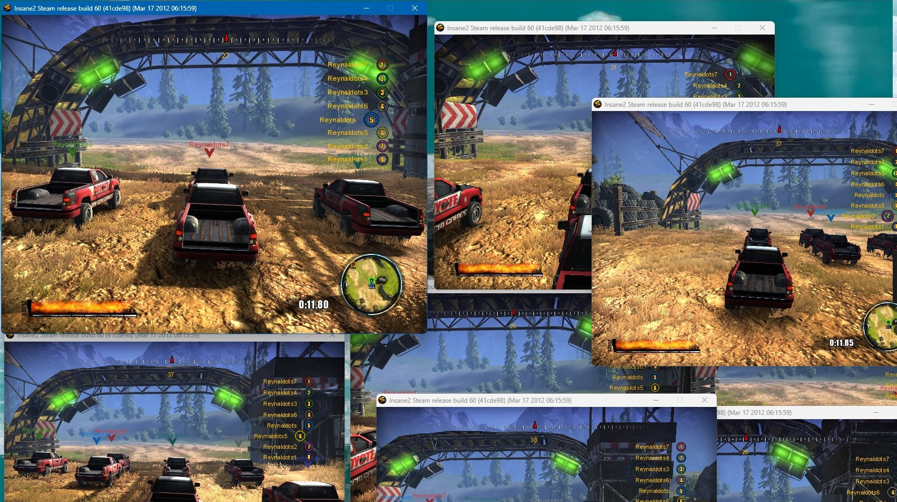
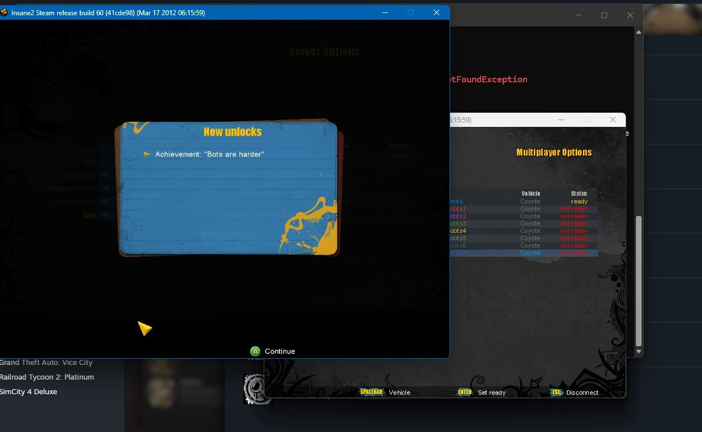
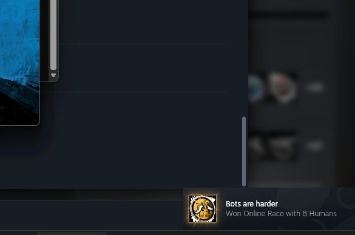
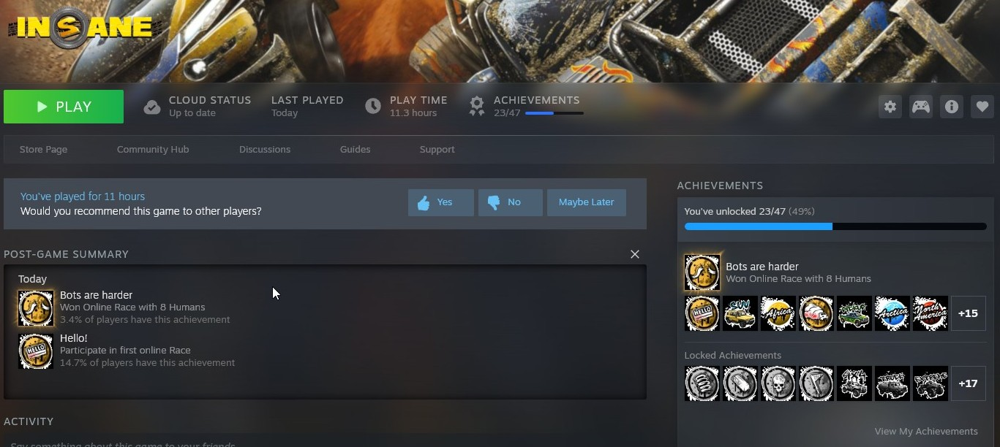
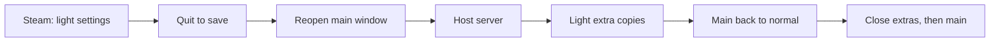
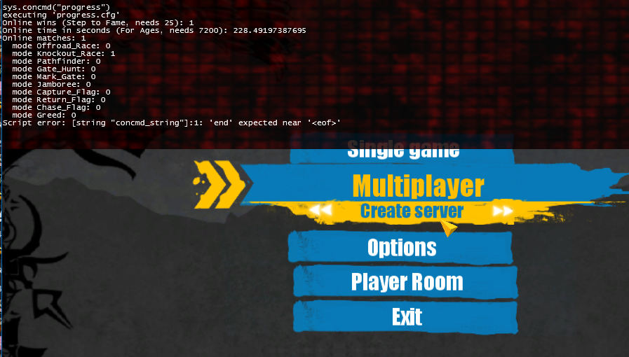

# Insane 2 - Local bot server for online achievements

**Read in:** English | [Português (Brasil)](README.pt-br.md) | [Русский](README.ru.md)

Insane 2 (Steam, 2011) has 7 online achievements, but nobody plays online anymore.
This project uses the multiplayer server **built into the game** to host matches against
bots on your own PC, and to run up to 8 copies of the game at once so you can get every
online achievement, including **"Bots are harder"** (win with 8 humans).

No game file is modified or redistributed: only `.cfg` files and PowerShell helper scripts.

> Tested on Windows 11 with the Steam version (release build 60).

---

## Quick run

Short path to play online and to fill all 8 human slots. The rest of this file is extra detail.

### 1. Prepare once

1. Download this repository, open **PowerShell** in its folder and run:

   ```powershell
   powershell -ExecutionPolicy Bypass -File .\tools\install.ps1
   ```

2. In Steam: right-click **Insane 2 > Properties > Launch Options** and type `-dev`.

   

   *Launch options in Steam with `-dev`, so the in-game console opens on F11.*

3. Start the game and press **F11**. The console must appear.

### 2. Online mode with bots

1. **Multiplayer > Create server**.
2. In the lobby, change **Bots** from `Forbidden` to **On free slots** (bots fill the empty slots).
3. Choose map, mode and laps.
4. The **Start** button refuses to start alone. Open the console (**F11**) and type:

   ```lua
   UI.MpServerLobbyWnd:StartMpGame()
   ```

5. Win the race. "Hello!" unlocks at the start of the first match.

### 3. Eight players ("Bots are harder")

The game counts 8 human slots. Bots do not fill those. Use the non-Steam server: the Steam menu rejects a second copy on the same account.

If the PC struggles with 8 copies, set the [light settings](#performance-light-settings-for-the-extra-copies) first.

1. Open Insane 2 **from Steam** (with `-dev`). This is the main window.
2. In the main menu, open the console (F11) and run:

   ```lua
   sys.concmd("exec host_bots.cfg")
   ```

   

   *Main window: `exec host_bots.cfg` starts the local server and opens the lobby.*

3. Open 7 extra copies (PowerShell, in the repository folder):

   ```powershell
   powershell -ExecutionPolicy Bypass -File .\tools\start_clients.ps1 -Clients 7
   ```

4. In **each** extra copy, when the main menu appears, press **F11** and type:

   ```lua
   sys.concmd("connect 127.0.0.1")
   ```

   The copy joins the lobby and stays **not ready**.

   

   *After connect, the copies are in the lobby and still not ready.*

5. In **each** window, press **Enter** or **A** to accept and become **ready**.

   

   *All 8 players marked ready.*

6. In the main window, start the race and **win it**. All 8 copies must be in the race (they can stay idle on the grid).

   

   *The race starts with the eight copies connected.*

7. When the race ends, **"Bots are harder"** shows as unlocked.

   

   *In-game notice: the achievement unlocked at the end of the race.*

8. Close the extra copies with `.\tools\start_clients.ps1 -StopAll`, then close the main window. When the game closes, Steam reports the unlock, and it shows up in the achievements list.

   

   *Steam reports the unlock when the game is closed.*

   

   *The achievement on the Steam achievements page.*

---

## Contents

- [Quick run](#quick-run)
- [Requirements](#requirements)
- [Installation](#installation)
- [Online achievements](#online-achievements)
- [Play against bots (all online achievements except "Bots are harder")](#play-against-bots)
- ["Bots are harder" with 8 copies of the game](#bots-are-harder-with-8-copies)
- [Performance: light settings for the extra copies](#performance-light-settings-for-the-extra-copies)
- [Console and command reference](#console-and-command-reference)
- [Troubleshooting](#troubleshooting)
- [Optional last resort](#optional-last-resort)
- [How it works](#how-it-works)
- [Disclaimer](#disclaimer)

---

## Requirements

- Insane 2 on Steam (your own copy) and the Steam client running.
- Windows PowerShell (comes with Windows).
- A decent PC if you want to run 8 copies at once (see [Performance](#performance-light-settings-for-the-extra-copies)).

## Installation

1. Download this repository (green **Code** button > **Download ZIP**, or `git clone`).
2. Open **PowerShell** in the repository folder and run:

   ```powershell
   powershell -ExecutionPolicy Bypass -File .\tools\install.ps1
   ```

   The script finds the game through the Steam registry and copies the `.cfg` files to
   `<Insane2>\data`. If it cannot find it, pass the folder:
   `.\tools\install.ps1 -GameDir "E:\SteamLibrary\steamapps\common\Insane2"`.
   It never touches the game's own `config.cfg`. Undo with `-Uninstall`.

3. In Steam: right-click **Insane 2 > Properties > Launch Options** and type:

   ```
   -dev
   ```

   Without `-dev` the in-game console does not open.

4. Start the game and press **F11**: the console must appear.

## Online achievements

| Achievement | Condition (from the game code) | With bots? |
|---|---|---|
| Hello! | Start any multiplayer level | Yes |
| For Ages | 2 hours in multiplayer (accumulated) | Yes |
| Step to Fame | 25 multiplayer wins | Yes |
| Very good Car | 10 multiplayer wins with the same car | Yes |
| Love of Diversity | 1 multiplayer win in each of the 10 modes | Yes |
| I know the Route | 1 multiplayer win on each of the 20 maps | Yes |
| Bots are harder | Win with the 8 human slots filled | Only with 8 copies of the game |
| Ram Ram | Head-on crash in split screen | Local split screen, no server needed |

Hosting counts: you do not need to be a client. Full details in [docs/achievements.md](docs/achievements.md).

When an online achievement unlocks, the game shows it after the race. Steam often shows its own notice only when you close the game.


*In-game notice: the achievement unlocked after the race.*

## Play against bots

The short steps are in [Quick run](#quick-run). Extra detail below.

**Option A - Steam server from the menu (simplest):**

1. **Multiplayer > Create server**.
2. In the lobby, change **Bots** from `Forbidden` to **On free slots** (bots fill the empty slots).
3. Choose map, mode and laps.
4. The **Start** button refuses to start alone ("There are no ready players connected...").
   Open the console (**F11**) and type:

   ```lua
   UI.MpServerLobbyWnd:StartMpGame()
   ```

5. Win the race. "Hello!" unlocks at the start of the first match.

**Option B - non-Steam server from the console** (needed for the 8 copies method):

```lua
sys.concmd("exec host_bots.cfg")
```

Then set **Bots: On free slots** in the lobby and start with `sys.concmd("start")`.

**Farming route, in plain words.** Two achievements ask you to win once in every mode and once
on every map. Doing that by hand means opening the lobby 20 times and changing the settings.
`route_01` to `route_20` do that setup for you. Each one is a single short race:

1. It picks a game mode and sets it to the smallest number of laps or points the game allows,
   so the race ends as soon as possible.
2. It loads one map.
3. You drive that race and finish first.

`route_01` to `route_10` each use a different mode, so 10 wins give you "Love of Diversity".
`route_01` to `route_20` together visit all 20 maps, so 20 wins give you "I know the Route".
Those 20 wins also count toward "Step to Fame" (25): win 5 more, and keep the same car the
whole time for "Very good Car" (10 wins on one car). `sys.concmd("progress")` shows what you
already have.

Example: `sys.concmd("route_01")` means "Offroad Race, 2 laps, map us1, load it now".

The automatic `map` command inside a route was not confirmed in every situation. If a route
does not load, or a map refuses a mode, pick the map and mode in the lobby and start with
`UI.MpServerLobbyWnd:StartMpGame()`, which is the path confirmed in testing.

## "Bots are harder" with 8 copies

The short steps are in [Quick run](#quick-run). Extra detail below.

The game counts the 8 human slots (bots use separate slots), so you need 8 copies of the game
connected. It works on a single PC and a single Steam account using the **non-Steam** server:

1. (Recommended) apply the [light settings](#performance-light-settings-for-the-extra-copies) first.
2. Open Insane 2 **from Steam** (with `-dev`). This is your main window.
3. In the main menu, open the console (F11) and run:

   ```lua
   sys.concmd("exec host_bots.cfg")
   ```

4. Open 7 extra copies (PowerShell, in the repository folder):

   ```powershell
   powershell -ExecutionPolicy Bypass -File .\tools\start_clients.ps1 -Clients 7
   ```

5. In **each** extra copy, when the main menu appears, press **F11** and type:

   ```lua
   sys.concmd("connect 127.0.0.1")
   ```

   The copy joins the lobby and stays **not ready**.
6. In **each** window, press **Enter** or **A** to accept and become **ready**.
7. In the main window, start the race and **win it**. All 8 copies must be in the race
   (they can stay idle on the grid). When it ends, **"Bots are harder"** shows as unlocked.
8. Close the extra copies with `.\tools\start_clients.ps1 -StopAll`, then close the main window.

> Do not use the Steam server from the menu for this: Steam rejects a second copy on the same
> account with **"Authorization error"**.

## Performance: light settings for the extra copies

All copies read and write the **same** settings file
(`Documents\My Games\insane2\user_config.cfg`: resolution, quality, volume).
Use that to make the extra copies light:

1. Open the game from Steam, go to **Options** and set a low resolution (e.g. 640x480, windowed),
   minimum quality and volume at zero.
2. **Quit the game** so the settings are saved.
3. Open it again from Steam: this is your main window. Host the server.
4. Open the extra copies with the script: they start with the light settings.
   (`start_clients.ps1` also forces 640x480 windowed, no sound/music, no MSAA, low shaders and
   no vsync. Use `-FullSettings` to disable that.)
5. **Only in the main window**, set your normal resolution, quality and audio again.
6. When you finish, **close the extra copies first and the main window last**:
   the last copy to close is the one that saves `user_config.cfg`.



## Console and command reference

The in-game console runs **Lua**. Console commands and the shortcuts below are called with
`sys.concmd("...")`. Inside `.cfg` files it is the other way around (commands directly, Lua with
`scriptRun '...'`).

| Typed in the console (F11) | What it does |
|---|---|
| `UI.MpServerLobbyWnd:StartMpGame()` | Starts the lobby match alone (same as `sys.concmd("start")`) |
| `sys.concmd("exec host_bots.cfg")` / `sys.concmd("server")` | Non-Steam server (`sv_start`) with bots, opens the lobby |
| `sys.concmd("connect 127.0.0.1")` | Joins the server on this PC (extra copies) |
| `sys.concmd("route_01")` ... `sys.concmd("route_20")` | One short race: sets a mode and a map, then loads it |
| `sys.concmd("mode_race")`, `mode_knockout`, `mode_pathfinder`, `mode_gatehunt`, `mode_markgate`, `mode_jamboree`, `mode_capture`, `mode_return`, `mode_chase`, `mode_greed` | Sets one mode with the minimum score or laps |
| `sys.concmd("map_us1")` ... `map_aq5` | Loads one map on the server |
| `sys.concmd("progress")` | Prints wins, time, modes and maps already won |
| `sys.concmd("stop")` | Stops the server |
| `MpStartNetLocator(); sys.concmd("findLanGames")` then `MpClientConnect(network.LANGames[1].address)` | Join through LAN search instead of an IP |

`sys.concmd("progress")` prints what you already have for the online achievements:



*Console output of `progress`: wins, time, modes and maps already done.*

Files installed in `<Insane2>\data`:

| File | Purpose |
|---|---|
| `autoexec.cfg` | Binds F11 to the console and loads `farm.cfg` |
| `farm.cfg` | Shortcuts (aliases) for server, modes, maps and the route |
| `host_bots.cfg` | Non-Steam server with 7 bots, Offroad Race, 2 laps |
| `progress.cfg` | Prints the online achievement statistics |
| `unlock_bots_are_harder.cfg` | Optional last resort (see below) |

## Troubleshooting

| Problem | Cause / fix |
|---|---|
| F11 does nothing | Missing `-dev` in Steam launch options |
| `attempt to call global 'scriptRun' (a nil value)` | The console runs Lua: type Lua directly or use `sys.concmd("...")` |
| "There are no ready players connected to the game except the server" | Bots do not count for the Start button: use `UI.MpServerLobbyWnd:StartMpGame()` |
| Lobby has "Bots: Forbidden" and no bot count | That option is only Forbidden / On free slots; On free slots fills all empty slots |
| Extra copy: "Authorization error" | You hosted through the Steam menu. Use `sys.concmd("exec host_bots.cfg")` |
| Extra copy does not find the server | The server list only shows Steam servers. Use `sys.concmd("connect 127.0.0.1")` in the extra copy |
| Automatic connect at startup does nothing | `-concmd` runs before the network is ready; connect manually from the menu |
| `.ps1` does nothing when typed in `cmd` | `cmd` does not run PowerShell scripts: use `powershell -ExecutionPolicy Bypass -File ...` |
| A second copy says "Can not run another copy" | Open extra copies with `start_clients.ps1` (it uses `-multiCopies`) |
| My resolution/volume got reset | An extra copy was closed last. Close extras first, main window last |

## Optional last resort

If you cannot run 8 copies, `unlock_bots_are_harder.cfg` is meant to unlock **"Bots are harder"**
the same way the game does when the condition is met:

```lua
sys.concmd("exec unlock_bots_are_harder.cfg")
```

**This was not tested in-game.** It should work, because it calls `Profile:UnlockAchievement`,
the same function the game calls when you earn an achievement, and that function sends the
unlock to Steam and saves the profile. The original `unlockAchievement` console command does
**not** work on PC: it is the Xbox 360 path and never reaches Steam. Prefer playing: the
8-copies method was tested and works.

## How it works

- [docs/reverse-engineering.md](docs/reverse-engineering.md): `.pak` format, hidden options
  (`-dev`, `-multiCopies`, `-concmd`), Lua console, Steam vs non-Steam servers, lobby checks.
- [docs/achievements.md](docs/achievements.md): all 47 achievements, internal names and real conditions.
- `tools/tpak_extract.py` and `tools/decompile.ps1` (optional, needs Python 3 and Java) extract
  and decompile the game's Lua scripts **locally** for study. The output is git-ignored.

## Disclaimer

Unofficial fan project, not affiliated with Targem Games or Game Factory Interactive.
You need your own copy of Insane 2. No game files are included in this repository.
Use at your own risk.
