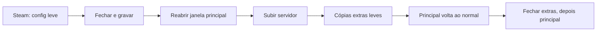

# Insane 2 - Servidor local com bots para os achievements online

**Leia em:** [English](README.md) | Português (Brasil) | [Русский](README.ru.md)

O Insane 2 (Steam, 2011) tem 7 achievements online, mas ninguém mais joga online.
Este projeto usa o servidor multiplayer **embutido no próprio jogo** para hospedar partidas
contra bots no seu PC, e abrir até 8 cópias do jogo ao mesmo tempo, para conseguir todos os
achievements online, inclusive o **"Bots are harder"** (vencer com 8 humanos).

Nenhum arquivo do jogo é alterado ou redistribuído: só arquivos `.cfg` e scripts PowerShell.

> Testado no Windows 11 com a versão Steam (release build 60).

---

## Sumário

- [Requisitos](#requisitos)
- [Instalação](#instalação)
- [Achievements online](#achievements-online)
- [Jogar contra bots](#jogar-contra-bots)
- ["Bots are harder" com 8 cópias](#bots-are-harder-com-8-cópias)
- [Desempenho: configurações leves para as cópias extras](#desempenho-configurações-leves-para-as-cópias-extras)
- [Referência de console e comandos](#referência-de-console-e-comandos)
- [Problemas comuns](#problemas-comuns)
- [Último recurso (opcional)](#último-recurso-opcional)
- [Como funciona](#como-funciona)
- [Aviso](#aviso)

---

## Requisitos

- Insane 2 na Steam (cópia própria) e a Steam aberta.
- Windows PowerShell (já vem no Windows).
- Um PC razoável se for rodar 8 cópias ao mesmo tempo (veja [Desempenho](#desempenho-configurações-leves-para-as-cópias-extras)).

## Instalação

1. Baixe este repositório (botão verde **Code** > **Download ZIP**, ou `git clone`).
2. Abra o **PowerShell** na pasta do repositório e rode:

   ```powershell
   powershell -ExecutionPolicy Bypass -File .\tools\install.ps1
   ```

   O script encontra o jogo pelo registro da Steam e copia os `.cfg` para `<Insane2>\data`.
   Se não encontrar, informe a pasta:
   `.\tools\install.ps1 -GameDir "E:\SteamLibrary\steamapps\common\Insane2"`.
   Ele nunca mexe no `config.cfg` original do jogo. Para desfazer: `-Uninstall`.

3. Na Steam: botão direito em **Insane 2 > Propriedades > Opções de inicialização** e digite:

   ```
   -dev
   ```

   Sem `-dev` o console do jogo não abre.

4. Abra o jogo e aperte **F11**: o console deve aparecer.

## Achievements online

| Achievement | Condição (código do jogo) | Com bots? |
|---|---|---|
| Hello! | Iniciar qualquer fase multiplayer | Sim |
| For Ages | 2 horas de multiplayer (acumuladas) | Sim |
| Step to Fame | 25 vitórias no multiplayer | Sim |
| Very good Car | 10 vitórias no multiplayer com o mesmo carro | Sim |
| Love of Diversity | 1 vitória multiplayer em cada um dos 10 modos | Sim |
| I know the Route | 1 vitória multiplayer em cada um dos 20 mapas | Sim |
| Bots are harder | Vencer com os 8 lugares humanos ocupados | Só com 8 cópias do jogo |
| Ram Ram | Batida de frente em tela dividida | Tela dividida local, sem servidor |

Hospedar conta: não precisa ser cliente. Detalhes em [docs/achievements.md](docs/achievements.md).

## Jogar contra bots

**Opção A - servidor Steam pelo menu (mais simples):**

1. **Multiplayer > Criar servidor**.
2. No lobby, mude **Bots** de `Forbidden` para **`Allowed`** (os bots preenchem as vagas vazias).
3. Escolha mapa, modo e voltas.
4. O botão **Iniciar** recusa começar sozinho ("There are no ready players connected...").
   Abra o console (**F11**) e digite:

   ```lua
   UI.MpServerLobbyWnd:StartMpGame()
   ```

5. Vença a corrida. O "Hello!" libera no início da primeira partida.

**Opção B - servidor sem Steam pelo console** (necessário para o método das 8 cópias):

```lua
sys.concmd("exec host_bots.cfg")
```

Depois deixe **Bots: Allowed** no lobby e inicie com `sys.concmd("start")`.

**Rota de farm, em palavras simples.** Dois achievements pedem uma vitória em cada modo e uma
vitória em cada mapa. Fazer isso na mão significa abrir o lobby 20 vezes e mudar as opções.
`route_01` até `route_20` fazem essa configuração por você. Cada uma é uma corrida curta:

1. Escolhe um modo e coloca o menor número de voltas ou pontos que o jogo aceita, para a
   corrida acabar o quanto antes.
2. Carrega um mapa.
3. Você corre e termina em primeiro.

`route_01` até `route_10` usam um modo diferente cada, então 10 vitórias dão "Love of Diversity".
`route_01` até `route_20` juntas passam pelos 20 mapas, então 20 vitórias dão "I know the Route".
Essas 20 vitórias também contam para "Step to Fame" (25): vença mais 5, e use o mesmo carro o
tempo todo para "Very good Car" (10 vitórias no mesmo carro). `sys.concmd("progress")` mostra
o que você já tem.

Exemplo: `sys.concmd("route_01")` significa "Offroad Race, 2 voltas, mapa us1, carregar agora".

O comando `map` automático dentro de uma rota não foi confirmado em todas as situações. Se uma
rota não carregar, ou um mapa recusar o modo, escolha mapa e modo no lobby e inicie com
`UI.MpServerLobbyWnd:StartMpGame()`, que é o caminho confirmado nos testes.

## "Bots are harder" com 8 cópias

O jogo conta os 8 lugares humanos (os bots usam lugares separados), então são necessárias 8
cópias do jogo conectadas. Funciona num PC só e numa conta Steam só, usando o servidor **sem Steam**:

1. (Recomendado) aplique antes as [configurações leves](#desempenho-configurações-leves-para-as-cópias-extras).
2. Abra o Insane 2 **pela Steam** (com `-dev`). Esta é a sua janela principal.
3. No menu principal, abra o console (F11) e rode:

   ```lua
   sys.concmd("exec host_bots.cfg")
   ```

4. Abra 7 cópias extras (PowerShell, na pasta do repositório):

   ```powershell
   powershell -ExecutionPolicy Bypass -File .\tools\start_clients.ps1 -Clients 7
   ```

5. Em **cada** cópia extra, quando o menu principal aparecer, aperte **F11** e digite:

   ```lua
   sys.concmd("connect 127.0.0.1")
   ```

   e marque a cópia como **pronta** no lobby.
6. Na janela principal, inicie a corrida e **vença**. As 8 cópias precisam estar na corrida
   (podem ficar paradas no grid).
7. Feche as cópias extras com `.\tools\start_clients.ps1 -StopAll` e depois a janela principal.

> Não use o servidor Steam do menu para isso: a Steam recusa uma segunda cópia na mesma conta
> com **"Authorization error"**.

## Desempenho: configurações leves para as cópias extras

Todas as cópias leem e gravam o **mesmo** arquivo de configurações
(`Documentos\My Games\insane2\user_config.cfg`: resolução, qualidade, volume).
Dá para usar isso para deixar as cópias extras leves:

1. Abra o jogo pela Steam, vá em **Options** e coloque resolução baixa (ex.: 640x480, janela),
   qualidade mínima e volume zero.
2. **Feche o jogo** para as configurações serem gravadas.
3. Abra de novo pela Steam: esta é a janela principal. Suba o servidor.
4. Abra as cópias extras pelo script: elas já começam com as configurações leves.
   (O `start_clients.ps1` também força 640x480 em janela, sem som/música, sem MSAA, shaders
   baixos e sem vsync. Use `-FullSettings` para desativar isso.)
5. **Só na janela principal**, volte para a resolução, qualidade e áudio normais.
6. Ao terminar, **feche primeiro as cópias extras e por último a janela principal**:
   a última cópia a fechar é a que grava o `user_config.cfg`.



## Referência de console e comandos

O console do jogo executa **Lua**. Comandos de console e os atalhos abaixo são chamados com
`sys.concmd("...")`. Dentro dos arquivos `.cfg` é o contrário (comandos direto, Lua com
`scriptRun '...'`).

| Digitado no console (F11) | O que faz |
|---|---|
| `UI.MpServerLobbyWnd:StartMpGame()` | Inicia a partida do lobby sozinho (igual a `sys.concmd("start")`) |
| `sys.concmd("exec host_bots.cfg")` / `sys.concmd("server")` | Servidor sem Steam (`sv_start`) com bots, abre o lobby |
| `sys.concmd("connect 127.0.0.1")` | Entra no servidor deste PC (cópias extras) |
| `sys.concmd("route_01")` ... `sys.concmd("route_20")` | Uma corrida curta: define um modo e um mapa e carrega |
| `sys.concmd("mode_race")`, `mode_knockout`, `mode_pathfinder`, `mode_gatehunt`, `mode_markgate`, `mode_jamboree`, `mode_capture`, `mode_return`, `mode_chase`, `mode_greed` | Define um modo com o mínimo de pontos ou voltas |
| `sys.concmd("map_us1")` ... `map_aq5` | Carrega um mapa no servidor |
| `sys.concmd("progress")` | Mostra vitórias, tempo, modos e mapas já vencidos |
| `sys.concmd("stop")` | Para o servidor |
| `MpStartNetLocator(); sys.concmd("findLanGames")` e depois `MpClientConnect(network.LANGames[1].address)` | Entrar pela busca de rede local em vez do IP |

Arquivos instalados em `<Insane2>\data`:

| Arquivo | Para que serve |
|---|---|
| `autoexec.cfg` | Liga o F11 ao console e carrega o `farm.cfg` |
| `farm.cfg` | Atalhos (aliases) de servidor, modos, mapas e rota |
| `host_bots.cfg` | Servidor sem Steam com 7 bots, Offroad Race, 2 voltas |
| `progress.cfg` | Mostra as estatísticas dos achievements online |
| `unlock_bots_are_harder.cfg` | Último recurso opcional (veja abaixo) |

## Problemas comuns

| Problema | Causa / solução |
|---|---|
| F11 não faz nada | Falta `-dev` nas opções de inicialização da Steam |
| `attempt to call global 'scriptRun' (a nil value)` | O console executa Lua: digite Lua direto ou use `sys.concmd("...")` |
| "There are no ready players connected to the game except the server" | Os bots não contam para o botão Iniciar: use `UI.MpServerLobbyWnd:StartMpGame()` |
| O lobby tem "Bots: Forbidden" e nenhuma quantidade de bots | A opção só tem Forbidden/Allowed; `Allowed` preenche todas as vagas vazias |
| Cópia extra: "Authorization error" | Você hospedou pelo menu da Steam. Use `sys.concmd("exec host_bots.cfg")` |
| Cópia extra não encontra o servidor | A lista de servidores só mostra servidores Steam. Use `sys.concmd("connect 127.0.0.1")` na cópia extra |
| O connect automático na inicialização não faz nada | O `-concmd` roda antes de a rede estar pronta; conecte à mão pelo menu |
| O `.ps1` não faz nada no `cmd` | O `cmd` não executa scripts PowerShell: use `powershell -ExecutionPolicy Bypass -File ...` |
| A segunda cópia diz "Can not run another copy" | Abra as cópias extras com o `start_clients.ps1` (ele usa `-multiCopies`) |
| Minha resolução/volume voltou ao baixo | Uma cópia extra foi fechada por último. Feche as extras antes da janela principal |

## Último recurso (opcional)

Se não conseguir rodar 8 cópias, o `unlock_bots_are_harder.cfg` serve para liberar o
**"Bots are harder"** do mesmo jeito que o jogo faz quando a condição é cumprida:

```lua
sys.concmd("exec unlock_bots_are_harder.cfg")
```

**Isso não foi testado no jogo.** Deve funcionar, porque chama `Profile:UnlockAchievement`,
a mesma função que o jogo chama quando você ganha um achievement, e essa função envia o
desbloqueio para a Steam e salva o perfil. O comando de console original `unlockAchievement`
**não** funciona no PC: é o caminho do Xbox 360 e nunca chega à Steam. Prefira jogar: o método
das 8 cópias foi testado e funciona.

## Como funciona

- [docs/reverse-engineering.md](docs/reverse-engineering.md): formato dos `.pak`, opções
  escondidas (`-dev`, `-multiCopies`, `-concmd`), console Lua, servidor Steam x sem Steam,
  verificações do lobby (em inglês).
- [docs/achievements.md](docs/achievements.md): os 47 achievements, nomes internos e condições reais (em inglês).
- `tools/tpak_extract.py` e `tools/decompile.ps1` (opcional, precisa de Python 3 e Java) extraem
  e descompilam os scripts Lua do jogo **localmente** para estudo. A saída é ignorada pelo git.

## Aviso

Projeto não oficial de fã, sem ligação com a Targem Games ou a Game Factory Interactive.
É preciso ter a sua própria cópia do Insane 2. Nenhum arquivo do jogo está neste repositório.
Use por sua conta e risco.
