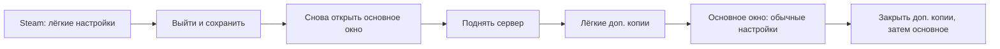

# Insane 2 - Локальный сервер с ботами для онлайн-достижений

**Читать на:** [English](README.md) | [Português (Brasil)](README.pt-br.md) | Русский

В Insane 2 (Steam, 2011) есть 7 онлайн-достижений, но в сеть больше никто не играет.
Этот проект использует **встроенный в игру** мультиплеерный сервер, чтобы проводить заезды
против ботов на своём ПК и запускать до 8 копий игры одновременно. Так можно получить все
онлайн-достижения, включая **«Bots are harder»** (победа при 8 живых игроках).

Файлы игры не изменяются и не распространяются: только файлы `.cfg` и скрипты PowerShell.

> Проверено на Windows 11 со Steam-версией (release build 60).

---

## Содержание

- [Требования](#требования)
- [Установка](#установка)
- [Онлайн-достижения](#онлайн-достижения)
- [Игра против ботов](#игра-против-ботов)
- [«Bots are harder» с 8 копиями](#bots-are-harder-с-8-копиями)
- [Производительность: лёгкие настройки для дополнительных копий](#производительность-лёгкие-настройки-для-дополнительных-копий)
- [Консоль и команды](#консоль-и-команды)
- [Решение проблем](#решение-проблем)
- [Крайняя мера (необязательно)](#крайняя-мера-необязательно)
- [Как это работает](#как-это-работает)
- [Отказ от ответственности](#отказ-от-ответственности)

---

## Требования

- Insane 2 в Steam (собственная копия) и запущенный клиент Steam.
- Windows PowerShell (входит в Windows).
- Достаточно мощный ПК, если запускать 8 копий одновременно (см. [Производительность](#производительность-лёгкие-настройки-для-дополнительных-копий)).

## Установка

1. Скачайте репозиторий (зелёная кнопка **Code** > **Download ZIP** или `git clone`).
2. Откройте **PowerShell** в папке репозитория и выполните:

   ```powershell
   powershell -ExecutionPolicy Bypass -File .\tools\install.ps1
   ```

   Скрипт находит игру через реестр Steam и копирует файлы `.cfg` в `<Insane2>\data`.
   Если папка не найдена, укажите её:
   `.\tools\install.ps1 -GameDir "E:\SteamLibrary\steamapps\common\Insane2"`.
   Оригинальный `config.cfg` игры не изменяется. Отмена: `-Uninstall`.

3. В Steam: правый клик по **Insane 2 > Свойства > Параметры запуска** и введите:

   ```
   -dev
   ```

   Без `-dev` консоль игры не открывается.

4. Запустите игру и нажмите **F11**: должна появиться консоль.

## Онлайн-достижения

| Достижение | Условие (из кода игры) | С ботами? |
|---|---|---|
| Hello! | Начать любой мультиплеерный уровень | Да |
| For Ages | 2 часа в мультиплеере (суммарно) | Да |
| Step to Fame | 25 побед в мультиплеере | Да |
| Very good Car | 10 побед в мультиплеере на одной машине | Да |
| Love of Diversity | 1 победа в мультиплеере в каждом из 10 режимов | Да |
| I know the Route | 1 победа в мультиплеере на каждой из 20 карт | Да |
| Bots are harder | Победа, когда заняты все 8 мест для людей | Только с 8 копиями игры |
| Ram Ram | Лобовое столкновение в режиме разделённого экрана | Локальный split screen, сервер не нужен |

Победа в роли хоста засчитывается. Подробности: [docs/achievements.md](docs/achievements.md).

## Игра против ботов

**Вариант A - Steam-сервер из меню (проще всего):**

1. **Multiplayer > Create server**.
2. В лобби смените **Bots** с `Forbidden` на **`Allowed`** (боты займут свободные места).
3. Выберите карту, режим и число кругов.
4. Кнопка **Start** не даёт начать одному («There are no ready players connected...»).
   Откройте консоль (**F11**) и введите:

   ```lua
   UI.MpServerLobbyWnd:StartMpGame()
   ```

5. Выиграйте заезд. «Hello!» открывается в начале первого матча.

**Вариант B - сервер без Steam через консоль** (нужен для способа с 8 копиями):

```lua
sys.concmd("exec host_bots.cfg")
```

Затем в лобби выставьте **Bots: Allowed** и начните командой `sys.concmd("start")`.

**Маршрут фарма простыми словами.** Два достижения требуют победы в каждом режиме и на каждой
карте. Вручную это значит 20 раз открывать лобби и менять настройки. `route_01` ... `route_20`
делают эту настройку за вас. Каждый маршрут - это один короткий заезд:

1. Выбирает режим и ставит минимум кругов или очков, который принимает игра, чтобы заезд
   закончился как можно быстрее.
2. Загружает одну карту.
3. Вы едете и финишируете первым.

`route_01` ... `route_10` используют по одному разному режиму, так что 10 побед дают
«Love of Diversity». `route_01` ... `route_20` вместе проходят все 20 карт, так что 20 побед
дают «I know the Route». Эти 20 побед также идут в «Step to Fame» (25): победите ещё 5 раз и
всё время используйте одну машину для «Very good Car» (10 побед на одной машине).
`sys.concmd("progress")` показывает, что уже есть.

Пример: `sys.concmd("route_01")` означает «Offroad Race, 2 круга, карта us1, загрузить сейчас».

Автоматическая команда `map` внутри маршрута проверена не во всех случаях. Если маршрут не
загружается или карта не принимает режим, выберите карту и режим в лобби и начните через
`UI.MpServerLobbyWnd:StartMpGame()`: этот способ подтверждён тестами.

## «Bots are harder» с 8 копиями

Игра считает 8 мест для людей (боты занимают отдельные места), поэтому нужно 8 подключённых
копий игры. Это работает на одном ПК и одном аккаунте Steam через сервер **без Steam**:

1. (Рекомендуется) сначала примените [лёгкие настройки](#производительность-лёгкие-настройки-для-дополнительных-копий).
2. Запустите Insane 2 **через Steam** (с `-dev`). Это ваше основное окно.
3. В главном меню откройте консоль (F11) и выполните:

   ```lua
   sys.concmd("exec host_bots.cfg")
   ```

4. Откройте 7 дополнительных копий (PowerShell, в папке репозитория):

   ```powershell
   powershell -ExecutionPolicy Bypass -File .\tools\start_clients.ps1 -Clients 7
   ```

5. В **каждой** дополнительной копии, когда появится главное меню, нажмите **F11** и введите:

   ```lua
   sys.concmd("connect 127.0.0.1")
   ```

   и отметьте копию как **готовую** в лобби.
6. В основном окне начните заезд и **победите**. Все 8 копий должны быть в заезде
   (они могут просто стоять на старте).
7. Закройте дополнительные копии командой `.\tools\start_clients.ps1 -StopAll`, затем основное окно.

> Не используйте для этого Steam-сервер из меню: Steam отклоняет вторую копию на том же
> аккаунте с ошибкой **«Authorization error»**.

## Производительность: лёгкие настройки для дополнительных копий

Все копии читают и записывают **один и тот же** файл настроек
(`Документы\My Games\insane2\user_config.cfg`: разрешение, качество, громкость).
Это можно использовать, чтобы дополнительные копии были лёгкими:

1. Запустите игру через Steam, в **Options** выставьте низкое разрешение (например, 640x480,
   в окне), минимальное качество и нулевую громкость.
2. **Выйдите из игры**, чтобы настройки сохранились.
3. Снова запустите через Steam: это основное окно. Поднимите сервер.
4. Откройте дополнительные копии скриптом: они стартуют уже с лёгкими настройками.
   (`start_clients.ps1` также принудительно ставит 640x480 в окне, без звука и музыки, без MSAA,
   с низкими шейдерами и без vsync. Отключить: `-FullSettings`.)
5. **Только в основном окне** верните обычное разрешение, качество и звук.
6. В конце **сначала закройте дополнительные копии, а основное окно - последним**:
   `user_config.cfg` сохраняет та копия, которая закрывается последней.



## Консоль и команды

Консоль игры выполняет **Lua**. Консольные команды и сокращения ниже вызываются через
`sys.concmd("...")`. В файлах `.cfg` наоборот (команды напрямую, Lua через `scriptRun '...'`).

| Ввод в консоли (F11) | Что делает |
|---|---|
| `UI.MpServerLobbyWnd:StartMpGame()` | Запускает матч из лобби в одиночку (то же, что `sys.concmd("start")`) |
| `sys.concmd("exec host_bots.cfg")` / `sys.concmd("server")` | Сервер без Steam (`sv_start`) с ботами, открывает лобби |
| `sys.concmd("connect 127.0.0.1")` | Подключение к серверу на этом ПК (доп. копии) |
| `sys.concmd("route_01")` ... `sys.concmd("route_20")` | Один короткий заезд: задаёт режим и карту и загружает их |
| `sys.concmd("mode_race")`, `mode_knockout`, `mode_pathfinder`, `mode_gatehunt`, `mode_markgate`, `mode_jamboree`, `mode_capture`, `mode_return`, `mode_chase`, `mode_greed` | Один режим с минимумом очков или кругов |
| `sys.concmd("map_us1")` ... `map_aq5` | Загружает одну карту на сервере |
| `sys.concmd("progress")` | Показывает победы, время, пройденные режимы и карты |
| `sys.concmd("stop")` | Останавливает сервер |
| `MpStartNetLocator(); sys.concmd("findLanGames")`, затем `MpClientConnect(network.LANGames[1].address)` | Подключение через поиск в локальной сети вместо IP |

Файлы, устанавливаемые в `<Insane2>\data`:

| Файл | Назначение |
|---|---|
| `autoexec.cfg` | Назначает F11 на консоль и загружает `farm.cfg` |
| `farm.cfg` | Сокращения (aliases) для сервера, режимов, карт и маршрута |
| `host_bots.cfg` | Сервер без Steam с 7 ботами, Offroad Race, 2 круга |
| `progress.cfg` | Показывает статистику онлайн-достижений |
| `unlock_bots_are_harder.cfg` | Необязательная крайняя мера (см. ниже) |

## Решение проблем

| Проблема | Причина / решение |
|---|---|
| F11 ничего не делает | Нет `-dev` в параметрах запуска Steam |
| `attempt to call global 'scriptRun' (a nil value)` | Консоль выполняет Lua: вводите Lua напрямую или используйте `sys.concmd("...")` |
| «There are no ready players connected to the game except the server» | Боты не учитываются кнопкой Start: используйте `UI.MpServerLobbyWnd:StartMpGame()` |
| В лобби «Bots: Forbidden» и нельзя выбрать количество ботов | Опция только Forbidden/Allowed; `Allowed` заполняет все свободные места |
| Доп. копия: «Authorization error» | Сервер создан через меню Steam. Используйте `sys.concmd("exec host_bots.cfg")` |
| Доп. копия не находит сервер | Список серверов показывает только Steam-серверы. В доп. копии: `sys.concmd("connect 127.0.0.1")` |
| Автоматическое подключение при запуске не работает | `-concmd` выполняется до готовности сети; подключайтесь вручную из меню |
| `.ps1` ничего не делает в `cmd` | `cmd` не запускает скрипты PowerShell: используйте `powershell -ExecutionPolicy Bypass -File ...` |
| Вторая копия пишет «Can not run another copy» | Открывайте доп. копии через `start_clients.ps1` (он использует `-multiCopies`) |
| Сбросились разрешение/громкость | Последней закрылась доп. копия. Закрывайте доп. копии раньше основного окна |

## Крайняя мера (необязательно)

Если запустить 8 копий не получается, `unlock_bots_are_harder.cfg` должен открыть
**«Bots are harder»** так же, как это делает игра при выполнении условия:

```lua
sys.concmd("exec unlock_bots_are_harder.cfg")
```

**В игре это не проверялось.** Должно сработать, потому что вызывается `Profile:UnlockAchievement` -
та же функция, которую игра вызывает при получении достижения, и она отправляет разблокировку
в Steam и сохраняет профиль. Оригинальная команда `unlockAchievement` на ПК **не работает**:
это путь Xbox 360, и до Steam она не доходит. Лучше играть: способ с 8 копиями проверен и работает.

## Как это работает

- [docs/reverse-engineering.md](docs/reverse-engineering.md): формат `.pak`, скрытые параметры
  (`-dev`, `-multiCopies`, `-concmd`), консоль Lua, Steam-сервер и сервер без Steam,
  проверки лобби (на английском).
- [docs/achievements.md](docs/achievements.md): все 47 достижений, внутренние имена и реальные условия (на английском).
- `tools/tpak_extract.py` и `tools/decompile.ps1` (необязательно, нужны Python 3 и Java)
  **локально** извлекают и декомпилируют Lua-скрипты игры для изучения. Результат игнорируется git.

## Отказ от ответственности

Неофициальный фанатский проект, не связан с Targem Games или Game Factory Interactive.
Нужна собственная копия Insane 2. Файлы игры в репозитории отсутствуют.
Используйте на свой страх и риск.
